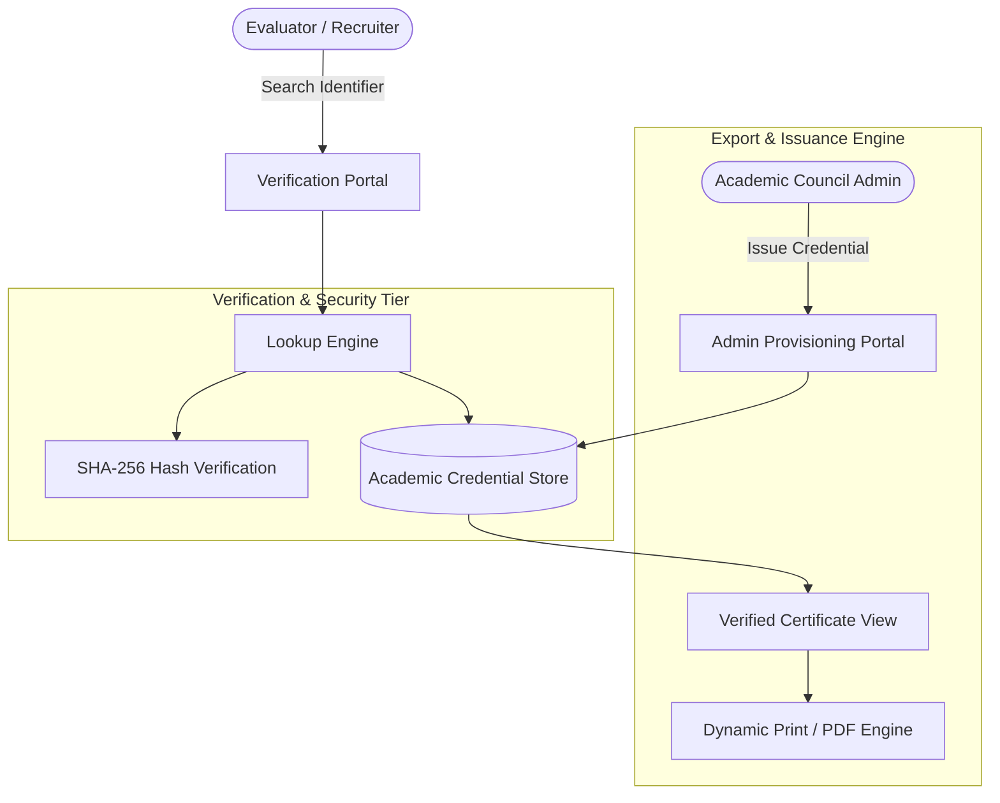

# ScholarVerify — Academic Credential Verification Platform

[](https://academic-certificate-engine.vercel.app)
[](https://react.dev/)
[](https://tailwindcss.com)
[](https://vitejs.dev/)
[](LICENSE)

An enterprise-grade, public academic credential verification engine built for international academic conferences, journals, and research consortia.

[Live Demo](https://academic-certificate-engine.vercel.app) &bull; [System Architecture](#system-architecture) &bull; [Quick Start](#quick-start)

---

## Problem & Real-World Use Case

In academic publishing and international conferences, universities and employers require immediate, verifiable authentication of attendee credentials, presentation citations, and committee recognitions. 

Manual verification workflows via email are slow, administratively burdensome, and vulnerable to credential fraud. **ScholarVerify** addresses this with:
- **Instant Cryptographic Verification:** Direct lookup via unique credential identifiers (e.g., `ACAD-2026-0891`) or recipient names.
- **Dynamic Certificate Rendering:** High-resolution digital certificate view featuring official seals, cryptographic hashes, and citation metadata.
- **Direct PDF Export:** Tailored print media styles enabling one-click high-definition document saving.
- **Administrative Issuance Console:** Integrated credential generation tool simulating academic council provisioning workflows.

---

## System Architecture



---

## Quick Start (Local Development)

```bash
# 1. Clone repository
git clone https://github.com/ShahAhmar/academic-certificate-verification-engine.git
cd academic-certificate-verification-engine

# 2. Install dependencies
npm install

# 3. Start development server
npm run dev
```

Application will run locally at `http://localhost:5173`.

---

## Deployment to Vercel

This repository is optimized for automated zero-configuration deployment on Vercel:

1. Push this repository to your GitHub account: `github.com/ShahAhmar/academic-certificate-verification-engine`.
2. Connect the repository in your Vercel dashboard.
3. Deploy without modifications.

---

## Evaluator Test Records

| Certificate Identifier | Recipient | Role | Conference Context |
| :--- | :--- | :--- | :--- |
| **`ACAD-2026-0891`** | Dr. Elena Rostova | Keynote Speaker | International Conference on Advanced Computing |
| **`CONF-2026-1044`** | Prof. Arthur Vance | Session Chair | Annual Symposium on Cloud Infrastructure |
| **`CERT-2026-3021`** | Syed Ahmar Ali | Lead Systems Architect | International Forum on Software Engineering |

---

## Author

**Syed Ahmar Ali**  
*Senior Full-Stack Engineer & Solutions Architect*  
- Portfolio: [ahmar.techgitsolutions.com](https://ahmar.techgitsolutions.com)  
- GitHub: [@ShahAhmar](https://github.com/ShahAhmar)  
- LinkedIn: [syed-ahmar-ali](https://linkedin.com/in/syed-ahmar-ali-0746bb34b)
