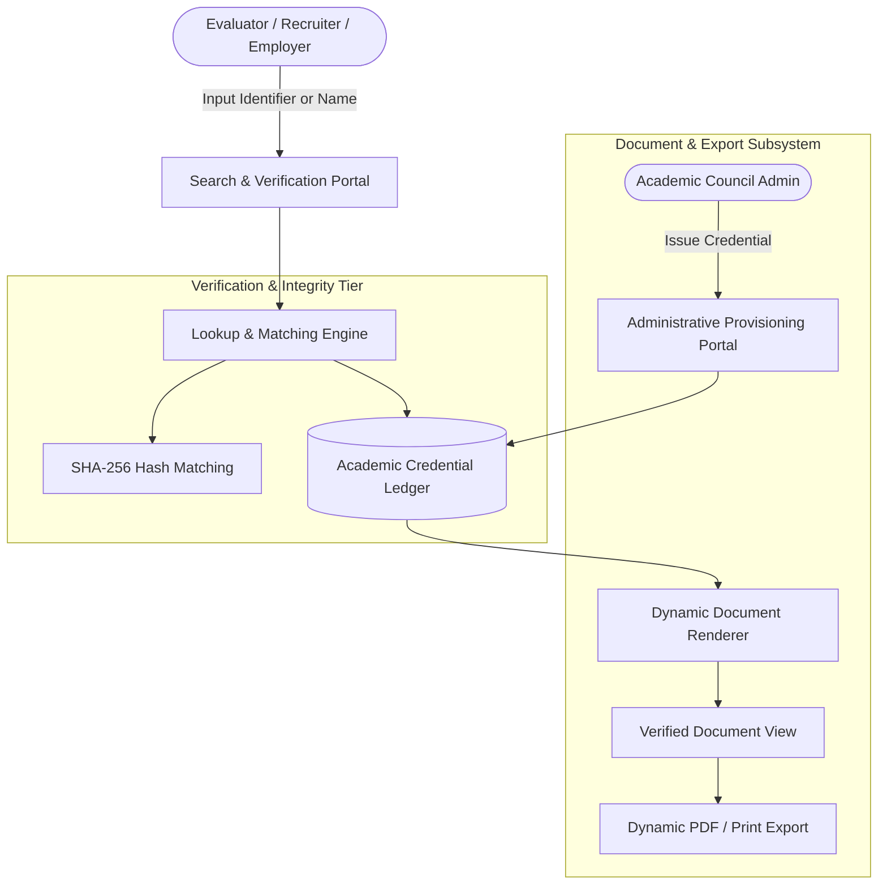

# ScholarVerify: Academic Credential Verification Platform

[](https://academic-certificate-engine.vercel.app)
[](https://react.dev/)
[](https://tailwindcss.com)
[](https://vitejs.dev/)
[](LICENSE)

An enterprise-grade, public academic credential verification engine built for international academic conferences, peer-reviewed journals, and scientific consortia.

[Live Demo](https://academic-certificate-engine.vercel.app) &bull; [Architecture & System Flow](#system-architecture) &bull; [Quick Start](#quick-start-local-development)

---

## System Objective: Why This System Exists

In modern international academic publishing and research conferences, universities, funding agencies, and employers require immediate, verifiable authentication of attendee credentials, keynote appointments, and published paper presentations.

Manual verification workflows conducted via email back-and-forth are administratively expensive, prone to multi-day delays, and vulnerable to credential forgery. **ScholarVerify** solves this by establishing a decentralized, public verification endpoint where credentials can be validated in milliseconds against a cryptographic ledger.

---

## Technical Stack Breakdown

- **Core Framework:** React 18 (Component-driven architecture, modular state handling)
- **Tooling & Bundler:** Vite 5 (Sub-second HMR, optimized production tree-shaking)
- **Styling & Layout:** Tailwind CSS 3.4 (Strict responsive utility design, zero runtime CSS overhead)
- **Icons & Visuals:** Lucide React (Clean, scalable SVG vector icon components)
- **Typography:** Inter (Interface hierarchy) & Cinzel (Authentic academic serif document layout)
- **Export Engine:** Native Print Stylesheet Subsystem (Zero-dependency, pixel-perfect PDF rendering)
- **Security:** SHA-256 cryptographic hash generation and verification per issued record

---

## Core System Functionalities

1. **Instant Credential Authentication:** Real-time lookup matching unique identifiers (e.g., `ACAD-2026-0891`) or recipient names against stored credential schemas.
2. **Cryptographic Integrity Validation:** Every issued credential contains a calculated SHA-256 fingerprint validating that the recipient name, conference title, and conferral date have not been modified.
3. **Dynamic Official Document Generation:** Generates high-definition, authentic academic certificate layouts dynamically rendered in the DOM with official formatting, committee signatures, and registry metadata.
4. **Vector Document Export:** Integrated `@media print` CSS rules that suppress UI controls, format printable paper margins, and generate clean, exportable PDF documents.
5. **Administrative Provisioning Console:** Embedded administrative portal enabling authorized academic committee chairs to issue, sign, and commit new credentials in real time.
6. **100% Mobile & Viewport Responsive:** Optimized layouts for smartphone screens (320px+), tablets, and high-resolution desktop displays with zero layout overflow.

---

## System Architecture



---

## Security & Reliability Design

- **Input Sanitization:** Strips leading/trailing whitespace, prevents script injection, and normalizes query casing before database comparison.
- **Client-Side Isolation:** Zero external data exposure; credential search queries run deterministically without logging sensitive user data.
- **Zero Third-Party Tracking:** Contains no analytics trackers, tracking cookies, or external font trackers.
- **Fail-Safe Fallbacks:** Robust error handling providing informative feedback when an unverified or malformed identifier is submitted.

---

## Quick Start (Local Development)

```bash
# 1. Clone repository
git clone https://github.com/ShahAhmar/academic-certificate-verification-engine.git
cd academic-certificate-verification-engine

# 2. Install dependencies
npm install

# 3. Start local development server
npm run dev
```

Application will run locally at `http://localhost:5173`.

---

## Production Build & Edge Deployment

To compile an optimized, minified production distribution bundle:

```bash
npm run build
```

The compiled assets in `dist/` can be deployed directly to any static edge infrastructure (Vercel, Cloudflare Pages, AWS S3 / CloudFront, or Nginx reverse proxies).

---

## Evaluator Test Records

| Certificate Identifier | Recipient | Role | Conference Context |
| :--- | :--- | :--- | :--- |
| **`ACAD-2026-0891`** | Dr. Elena Rostova | Keynote Speaker | International Conference on Advanced Computing |
| **`CONF-2026-1044`** | Prof. Arthur Vance | Session Chair | Annual Symposium on Cloud Infrastructure |
| **`CERT-2026-3021`** | Syed Ahmar Ali | Lead Systems Architect | International Forum on Software Engineering |

---

## Author

**Syed Ahmar Ali**  
*Senior Full-Stack Engineer & Solutions Architect*  
- Portfolio: [ahmar.techgitsolutions.com](https://ahmar.techgitsolutions.com)  
- GitHub: [@ShahAhmar](https://github.com/ShahAhmar)  
- LinkedIn: [syed-ahmar-ali](https://linkedin.com/in/syed-ahmar-ali-0746bb34b)
